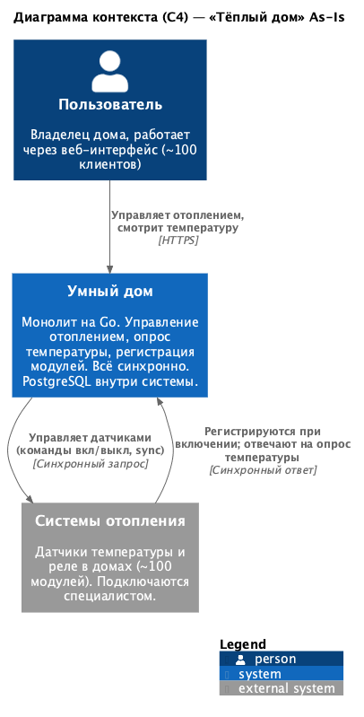
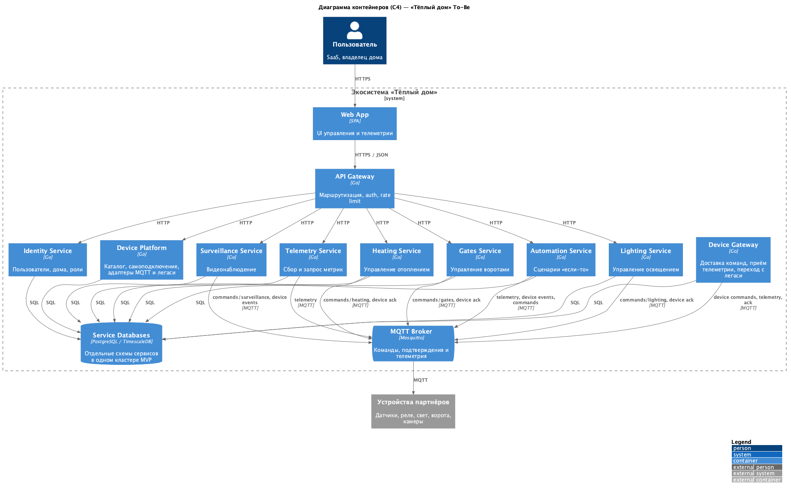
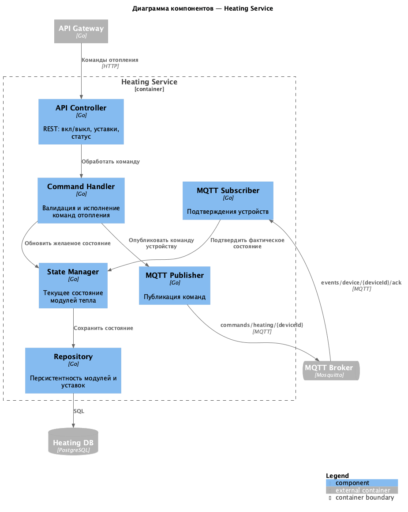
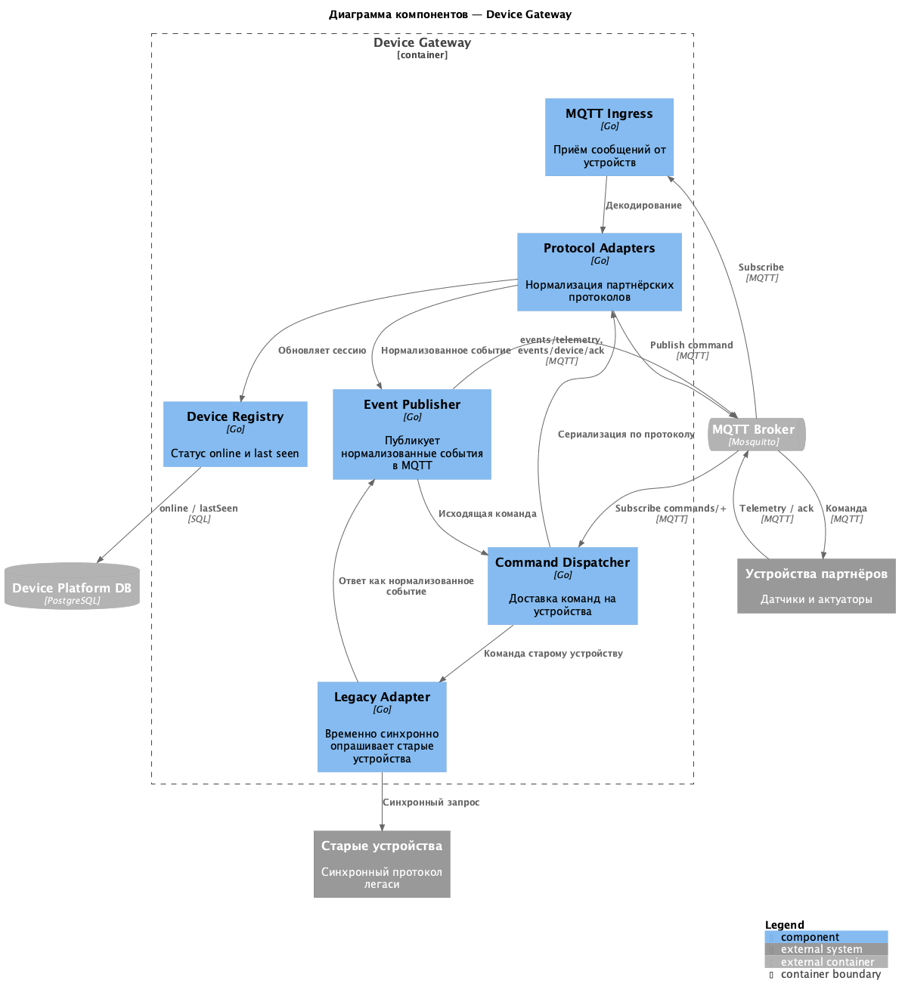
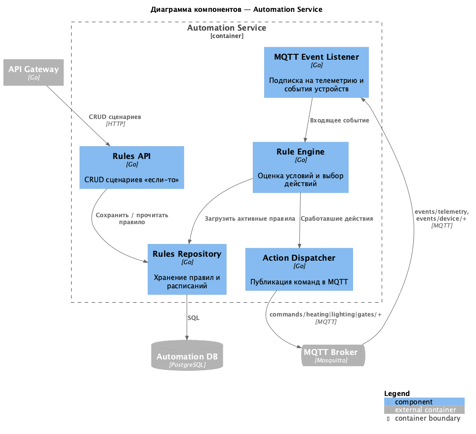
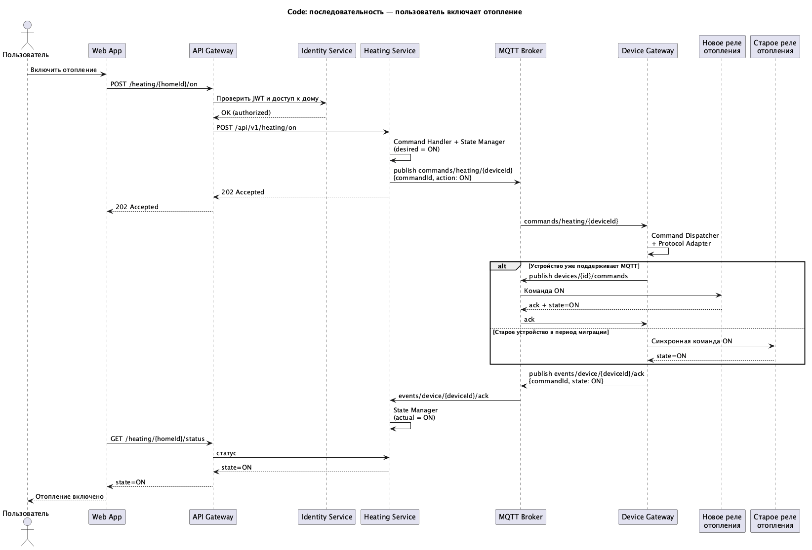
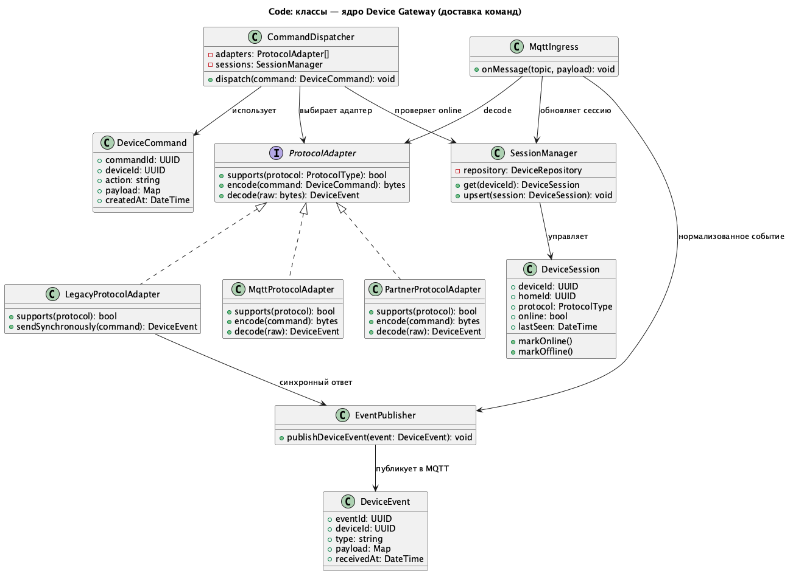
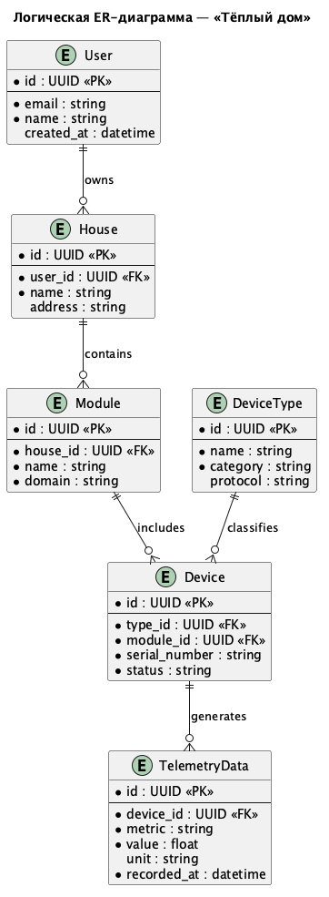

# Project_template

Это шаблон для решения проектной работы. Структура этого файла повторяет структуру заданий. Заполняйте его по мере работы над решением.

# Задание 1. Анализ и планирование

### 1. Описание функциональности монолитного приложения

**Управление отоплением:**

- Пользователи могут удалённо включать/выключать отопление в своих домах через приложение.
- Подключение датчиков к текущей версии системы сопровождается выездом специалиста.

**Мониторинг температуры:**

- Система получает данные о температуре с датчиков, установленных в домах.
- Пользователи могут просматривать текущую температуру в своих домах через веб-интерфейс.

### 2. Анализ архитектуры монолитного приложения

- **Язык программирования:** Go
- **База данных:** PostgreSQL
- **Архитектура:** Монолитная, все компоненты системы (обработка запросов, бизнес-логика, работа с данными) находятся в рамках одного приложения.
- **Взаимодействие:** Синхронное, запросы обрабатываются последовательно.
- **Масштабируемость:** Ограничена, так как монолит сложно масштабировать по частям.
- **Развертывание:** Требует остановки всего приложения. 

### 3. Определение доменов и границы контекстов

| Контекст | Ответственность | Граница As-Is |
|---|---|---|
| **Управление устройствами** | Регистрация модулей, состояние, команды к реле/датчикам | Только для отопления; регистрация через выезд специалиста |
| **Телеметрия / мониторинг** | Сбор и отображение температуры (далее — потоки с датчиков) | Сервер синхронно опрашивает датчик |
| **Управление отоплением** | Включение/выключение отопления, работа с модулями тепла | Внутри монолита |
| **Идентификация и доступ пользователей** | Веб-клиенты, привязка пользователя к дому/устройствам | Внутри монолита |
| **Освещение / ворота / видеонаблюдение / прочее** (to-be) | Отдельные продуктовые домены из целевого MVP | Отсутствуют |
| **Каталог / онбординг устройств** (to-be) | Самоподключение, партнёрские протоколы, модульные комплекты | Отсутствует |
| **Сценарии автоматизации** (to-be) | Правила «если–то» между модулями умного дома | Отсутствует |

### 4. Проблемы монолитного решения

Текущее решение приемлемо лля одного типа устройств, может испытывать проблемы с производительностью при 1000+ подключений. Оно **не закрывает** бизнес-цели (SaaS, модули, самоподключение, партнёры, несколько регионов).  

Основные проблемы:  

- **Масштабирование нагрузки и функций.** Один процесс обслуживает UI, команды, опрос датчиков и работу с БД. Нельзя независимо масштабировать телеметрию и управление при росте до экосистемы посёлков.
- **Только синхронный pull.** Сервер инициирует опрос и управление датчиком. Это плохо стыкуется с нестабильным интернетом в домах, партнёрскими устройствами и удалённым наблюдением в реальном времени.
- **Узкий продуктовый контур.** Поддерживается только отопление. Освещение, ворота, камеры и неизвестные датчики потребуют раздувания кода без изоляции доменов.
- **Онбординг через специалиста.** Нет self-service SaaS: каждое подключение = выезд. Модель не масштабируется на несколько регионов.
- **Развёртывание и отказоустойчивость.** Любое изменение или падение останавливает всё приложение; нет изоляции сбоев между доменами.
- **Эволюция командой.** Пять разработчиков будут делить один монолит при параллельной работе над MVP-модулями (отопление / свет / ворота / наблюдение).
- **Интеграция партнёров.** Нет границы для стандартных протоколов и каталога устройств; протокол «сервер → датчик» жёстко зашит в монолит.

### 5. Визуализация контекста системы — диаграмма C4

Диаграмма контекста (C4 Level 1) показывает, как монолит «Тёплый дом / Умный дом» взаимодействует с пользователями и внешними системами отопления (датчики и реле). PostgreSQL относится к уровню контейнеров и на Context не выносится.

Исходник: [docs/c4/c4-context-as-is.puml](docs/c4/c4-context-as-is.puml)



# Задание 2. Проектирование микросервисной архитектуры

### Решение для MVP и обоснование MQTT

Целевая система разделена по продуктовым областям: отопление, свет, ворота и наблюдение. Это позволяет развивать модули независимо, но не добавляет отдельную инфраструктуру для каждой небольшой задачи.

Для MVP выбран **один MQTT-брокер**, а Kafka и Redis не используются. MQTT подходит для команд, подтверждений и телеметрии: устройство может само прислать данные, а доставка не блокирует веб-интерфейс. Он также проще в эксплуатации для команды из пяти человек. Видеопоток через MQTT не передаётся: для камеры в MQTT идут только команды, состояние и тревожные события.

**Device Platform** хранит каталог и данные самоподключения. **Device Gateway** принимает MQTT-сообщения, доставляет команды и изолирует особенности протоколов устройств. Доменные сервисы публикуют нормализованные команды в MQTT и получают подтверждения; они не работают с протоколом конкретного устройства.

Команды передаются с MQTT QoS 1 и содержат `commandId`: повторная доставка не должна выполнить действие второй раз. Состояние в PostgreSQL остаётся источником данных для API; `actualState` меняется только после подтверждения от устройства.

**Переход с синхронного легаси:**

1. Сначала выделяется Device Gateway с Legacy Adapter. Он продолжает синхронно опрашивать старые устройства и посылать им команды.
2. Результат опроса или команды Gateway публикует как единое MQTT-событие. Новые сервисы уже используют асинхронный контракт.
3. Затем выделяется Heating Service: HTTP-команда получает ответ `202 Accepted`, а фактическое состояние обновляется после MQTT-подтверждения.
4. Новые устройства подключаются к MQTT напрямую. Старые работают через адаптер до замены; после этого по тому же шаблону выделяются сервисы света, ворот и наблюдения.

**Диаграмма контейнеров (Containers)**

Исходник: [docs/c4/c4-containers-to-be.puml](docs/c4/c4-containers-to-be.puml)



**Диаграмма компонентов (Components)**

Детализированы ключевые сервисы: управление доменом (Heating), связь с устройствами и легаси (Device Gateway), сценарии (Automation). Lighting / Gates / Surveillance устроены по тому же шаблону, что и Heating.

Исходник: [docs/c4/c4-components-heating.puml](docs/c4/c4-components-heating.puml)



Исходник: [docs/c4/c4-components-device-hub.puml](docs/c4/c4-components-device-hub.puml)



Исходник: [docs/c4/c4-components-automation.puml](docs/c4/c4-components-automation.puml)



**Диаграмма кода (Code)**

Исходник: [docs/c4/c4-code-heating-command-sequence.puml](docs/c4/c4-code-heating-command-sequence.puml)



Исходник: [docs/c4/c4-code-device-hub-classes.puml](docs/c4/c4-code-device-hub-classes.puml)



# Задание 3. Разработка ER-диаграммы

### Сущности и атрибуты

| Сущность | Атрибуты |
|---|---|
| **User** | `id`, `email`, `name`, `created_at` |
| **House** | `id`, `user_id` (FK), `name`, `address` |
| **DeviceType** | `id`, `name`, `category`, `protocol` |
| **Module** | `id`, `house_id` (FK), `name`, `domain` |
| **Device** | `id`, `type_id` (FK), `module_id` (FK), `serial_number`, `status` |
| **TelemetryData** | `id`, `device_id` (FK), `metric`, `value`, `unit`, `recorded_at` |

### Связи

- **User — House:** один пользователь владеет несколькими домами; каждый дом принадлежит одному пользователю.
- **House — Module:** в доме несколько модулей (отопление, свет и т.д.); модуль привязан к одному дому.
- **Module — Device:** модуль содержит несколько устройств; устройство входит в один модуль.
- **DeviceType — Device:** один тип описывает много устройств; у устройства один тип.
- **Device — TelemetryData:** устройство генерирует много записей телеметрии.

### ER-диаграмма

Исходник: [docs/er/er-logical.puml](docs/er/er-logical.puml)



# Задание 4. Создание и документирование API

### 1. Тип API

Укажите, какой тип API вы будете использовать для взаимодействия микросервисов. Объясните своё решение.

### 2. Документация API

Здесь приложите ссылки на документацию API для микросервисов, которые вы спроектировали в первой части проектной работы. Для документирования используйте Swagger/OpenAPI или AsyncAPI.

# Задание 5. Работа с docker и docker-compose

Перейдите в apps.

Там находится приложение-монолит для работы с датчиками температуры. В README.md описано как запустить решение.

Вам нужно:

1) сделать простое приложение temperature-api на любом удобном для вас языке программирования, которое при запросе /temperature?location= будет отдавать рандомное значение температуры.

Locations - название комнаты, sensorId - идентификатор названия комнаты

```
	// If no location is provided, use a default based on sensor ID
	if location == "" {
		switch sensorID {
		case "1":
			location = "Living Room"
		case "2":
			location = "Bedroom"
		case "3":
			location = "Kitchen"
		default:
			location = "Unknown"
		}
	}

	// If no sensor ID is provided, generate one based on location
	if sensorID == "" {
		switch location {
		case "Living Room":
			sensorID = "1"
		case "Bedroom":
			sensorID = "2"
		case "Kitchen":
			sensorID = "3"
		default:
			sensorID = "0"
		}
	}
```

2) Приложение следует упаковать в Docker и добавить в docker-compose. Порт по умолчанию должен быть 8081

3) Кроме того для smart_home приложения требуется база данных - добавьте в docker-compose файл настройки для запуска postgres с указанием скрипта инициализации ./smart_home/init.sql

Для проверки можно использовать Postman коллекцию smarthome-api.postman_collection.json и вызвать:

- Create Sensor
- Get All Sensors

Должно при каждом вызове отображаться разное значение температуры

Ревьюер будет проверять точно так же.


